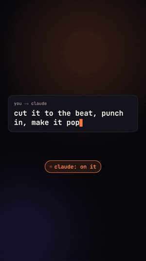
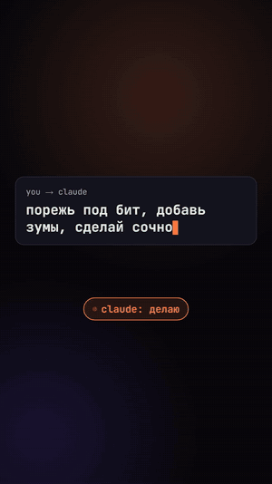

# claude-resolve-mcp

**Edit videos in DaVinci Resolve with Claude — including the free version.**
Claude assembles the timeline, cuts to the beat, adds motion effects and kinetic text, mixes audio,
renders, and checks its own result.

[Русский ниже](#русский)

> Not affiliated with Blackmagic Design or Anthropic. Tested on **DaVinci Resolve 21.1 Free, Windows 11**.

<p align="center">
  <a href="docs/promo_en.mp4"></a><br>
  <sub>▶ <a href="docs/promo_en.mp4">Watch the full promo with sound (19 s)</a> — made with this kit: the DaVinci footage is a real screen recording of Claude working through the bridge, motion graphics in Remotion.</sub>
</p>

---

## Why

The free DaVinci Resolve blocks external scripting, and 21.1 also removed the in-app Python console.
That's why Python-based Resolve MCP servers can't connect to Resolve 21.1 Free.

It runs a **Lua bridge inside Resolve** (started from Resolve's Lua console). It talks to Claude through a file queue
and works around the Lua sandbox (no `io`/`os` — files are written via LuaJIT `ffi`).
It also solves the main gotcha: **Fusion comps created through the API don't show up in renders** until the
change goes through Resolve's undo system — this is handled automatically, no clicking in the Fusion page.

## Features

| | |
|---|---|
| **Timeline** | import, clip placement on tracks with exact in/out, markers, transforms, volume, render |
| **Motion (Fusion)** | zoom punch, slow zoom, shake, flash, blur-in, glitch, RGB split, strobe, vignette, tint, overexpose; animated titles |
| **Text & graphics** | kinetic typography with [Remotion](https://www.remotion.dev) → ProRes 4444 with alpha → top track |
| **Footage analysis** | word-level speech timings (Whisper), beats and accents (librosa), Media Pool contact sheet, reference style breakdown (cut rate, zooms, flashes) |
| **Audio** | loudness in LUFS, one-channel voice → centered mono, music ducking under voice, peak control |
| **QC** | frames from the finished render, contact sheets, numeric checks that effects actually rendered |
| **Misc** | proxies for smooth editing, subtitles from SRT, license-plate detection and blur |

Three Claude Code agents: **footage-analyst** (material → edit plan), **resolve-operator** (executes the plan
in Resolve), **render-qc** (checks the render).

No built-in style: fonts, colors, pacing and look come from your request or a reference video. Defaults are neutral.

## Requirements

- Windows 10/11, DaVinci Resolve 18+ (Free or Studio). macOS/Linux are untested (the bridge uses portable paths and ffi, so it may work).
- [Claude Code](https://docs.claude.com/en/docs/claude-code) (CLI or desktop app)
- [uv](https://docs.astral.sh/uv/) (installs Python for you)
- Node.js 18+ — only for Remotion text/graphics

## Install

```powershell
git clone https://github.com/<you>/claude-resolve-mcp
cd claude-resolve-mcp
powershell -ExecutionPolicy Bypass -File install.ps1 -Motion
```

`install.ps1` installs dependencies, generates the bridge loader `bridge/start.lua` and writes `.mcp.json`. It doesn't touch Resolve's own folders.
`-Motion` also installs Remotion. Optional official Remotion skills for Claude: `cd motion && npx remotion skills add`.

## Run

1. Open your project in DaVinci Resolve.
2. **Workspace → Console**, switch to the **Lua** tab, paste the line printed by `install.ps1` and press Enter:
   `dofile([[C:/path/to/claude-resolve-mcp/bridge/start.lua]])`. You'll see a `[ResolveBridge] ...` line with `resolve=true`.
   The bridge runs in the background; start it once after each Resolve launch. (The Workspace → Scripts menu doesn't work for this.)
3. Open Claude Code in the repo folder and describe what you want:

```
Look at the footage in the Media Pool and build a 15-second intro to the music track:
hook on the drop, cuts on the beat, zoom punches on accents, key words as kinetic text.
```
```
Balance the voice and the music, duck the music under speech.
```
```
Break down the editing style of refs/example.mp4 and match my edit's pacing to it.
```

Claude decides what to use: MCP tools, Lua through the bridge, or scripts from `tools/`.

## How it works

```
Claude Code ──MCP──► resolve_mcp/server.py ──► queue/req.lua ──► [Resolve] bridge/ResolveBridge.lua
                                         ◄── queue/resp.json ◄──      └─ bridge/helpers.lua (effects, utils)
tools/*.py  — analysis, audio, QC, proxies (work on files, some go through the bridge)
motion/     — Remotion: text and graphics with alpha
```

- `bridge/helpers.lua` and `bridge/runtime.lua` are re-read on every request — edit them without restarting the bridge.
- Arbitrary Lua inside Resolve: the `run_resolve_lua` tool or `uv run python tools/rl.py file.lua`.
- All verified API pitfalls are in [CLAUDE.md](CLAUDE.md) (Claude reads it automatically).
- Code comments are mostly in Russian.

## Limitations

- The API can't set keyframes in the Edit page inspector — animation goes through Fusion or Remotion.
- Claude "sees" the edit through frames and numbers, not in real time: complex scenes take a few iterations.
- Remotion is free for individuals and small companies; others need a [Remotion license](https://www.remotion.dev/license).
- If you have **Resolve Studio** and want the whole API exposed as tools, also look at
  [samuelgursky/davinci-resolve-mcp](https://github.com/samuelgursky/davinci-resolve-mcp).

## License

[GPL-3.0-or-later](LICENSE): use, change and share freely; if you distribute a modified version,
its source must stay open under the same license. Dependencies (Remotion, Whisper, etc.) keep their own licenses.

---

## Русский

**Монтаж в DaVinci Resolve вместе с Claude, в том числе в бесплатной версии.**

<p align="center">
  <a href="docs/promo_ru.mp4"></a><br>
  <sub>▶ <a href="docs/promo_ru.mp4">Смотреть промо целиком со звуком (19 с)</a> — сделано этим же набором: DaVinci — настоящая запись экрана, где Claude работает через мост, графика — Remotion.</sub>
</p>

Бесплатный Resolve не пускает внешние скрипты, а в 21.1 из него убрали и Python-консоль, поэтому MCP-серверы
на Python к Resolve 21.1 Free не подключаются. Здесь мост на **Lua** запускается внутри Resolve (из Lua-консоли),
общается с Claude через файлы и обходит песочницу. Решена и главная проблема: Fusion-эффекты, созданные через API,
не попадали в рендер, а мост активирует их через систему отмены (undo) автоматически.

**Умеет:** сборка таймлайна, моушен-эффекты Fusion, кинетический текст (Remotion), анализ материала
(речь, биты, раскадровки, разбор стиля референса), сведение звука (LUFS, даккинг, голос из одного канала),
проверка рендера, прокси, субтитры, размытие номеров. Стиль не зашит: оформление задаёшь ты.

**Установка (Windows):** поставь [uv](https://docs.astral.sh/uv/) (и Node.js для Remotion), затем
`powershell -ExecutionPolicy Bypass -File install.ps1 -Motion`.
**Запуск:** в Resolve открой *Workspace → Console*, вкладка **Lua**, вставь строку `dofile(...)`, которую напечатал `install.ps1`, открой Claude Code в папке репозитория и опиши монтаж словами.

**Лицензия:** GPL-3.0. Пользоваться, менять и делиться можно свободно; кто распространяет изменённую версию,
обязан открыть её код под той же лицензией.

---

<p align="center">
  <sub>This whole repository was written by Claude while editing real videos — to give itself hands inside DaVinci Resolve.<br>
  Весь этот репозиторий написал Claude, пока монтировал настоящие ролики, чтобы получить руки внутри DaVinci Resolve.</sub>
</p>

<p align="center">
  <i><b>Who better to build hands for a program than Claude —<br>the one who needs hands that can reach anywhere?</b></i>
</p>

<p align="center">
  <i>Кто напишет программе руки лучше, чем Claude,<br>которому самому нужны руки, дотягивающиеся куда угодно?</i>
</p>
